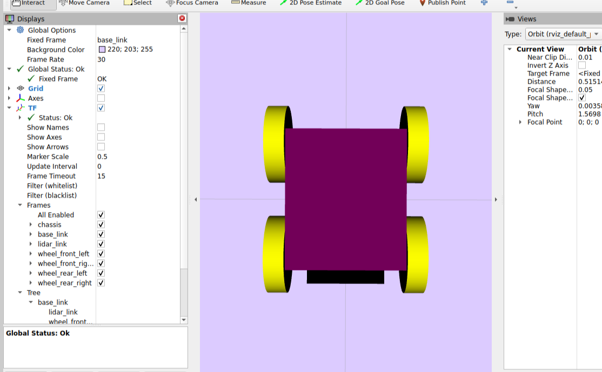

# ROS 2 Jazzy Wheeled Robot #

URDF model of a four-wheeled mobile robot with a rigid body rectangular chassis and fixed front-mounted LiDAR sesnor based on the [HPS-3D160-U ToF Solid-State LiDAR Sensor.]([text](https://wiki.dfrobot.com/dfr0728/)) Project focus primarily explores configuring URDF robot geometry, coordinate frames, URDF joints (revolute & fixed types), and URDF links.

## Preview



## Requirements

- [Ubuntu 24.04 LTS](https://documentation.ubuntu.com/release-notes/24.04/)
- [ROS 2 Jazzy — Ubuntu Installation](https://docs.ros.org/en/jazzy/Installation/Ubuntu-Install-Debs.html)
- Graphical URDF Viewer (RViz2)

My development environment utilized Windows 11 Visual Studio Code and Ubuntu 24.04 through [WSL2](https://learn.microsoft.com/en-us/windows/wsl/install)

## Installation 

### Install Dependencies

From the point of installing ROS 2 Jazzy:

```bash
source /opt/ros/jazzy/setup.bash

sudo apt update
sudo apt install ros-jazzy-robot-state-publisher -y
sudo apt install ros-jazzy-joint-state-publisher-gui -y
sudo apt install ros-jazzy-rviz2 -y
sudo apt install iburdfdom-tools -y
```

### Clone Repository
```bash
mkdir -p ~/ros2_jazzy/src
cd ~/ros2_jazzy/src

git clone https://github.com/nfry25/ROS2-Jazzy-Wheeled-Robot.git jazzy_robot
```

The ROS package is inside its inner `jazzy_robot` folder.

## Usage

### URDF Structure Validation

```bash
source /opt/ros/jazzy/setup.bash
cd ~/ros2_jazzy/src/jazzy_robot/jazzy_robot

check_urdf urdf/jazzy_wheeled_robot.urdf
```

URDF structure validated when the check prints the robot's link tree. The check does not validate physical behaviors or the visualization or placement of every element.


### Direct Source Launch

```bash
cd ~/ros2_jazzy/src/jazzy_robot/jazzy_robot

ros2 launch ./launch/display.launch.py
```
This will launch:
- `robot_state_publisher` publishing robot's link transform.
- `joint_state_publisher_gui` joint slider GUI for visualization.
- `rviz2` displays the robot model.

### Configuring RViz2

Ensure Rviz2 configurations are set to the following to ensure the robot is able to be displayed.

| Setting | Value |  
|---|---|
| Global Options → Fixed Frame | `base_link` |
| Add Display | `RobotModel`  |
| RobotModel → Description Source | `Topic` |
| RobotModel → Description Topic| `/robot_description`  |


## Robot Model

### Dimensions

All measurements for the URDF are converted to meters and angles to radians.

| Measurement | Value (m) |
|---|---:|
| Chassis Length  | 0.140 |
| Chassis Width | 0.120 |
| Chassis Height  | 0.060 |
| Ground Clearance  | 0.010 |
| Wheel Radius  | 0.040 |
| Wheel Width | 0.020 |
| Axle Spacing  | 0.115 |
| Wheel-Center Spacing  | 0.140 |

### Coordinate Frames

Assumes a right-hand coordinate system: 

- **+X:** Forward
- **+Y:** Left
- **+Z:** Upward


The parent link (`base_link`) frame provides the ground reference frame. The chassis and wheel centers sit at 0.040 m above this frame.

Wheel rotation axes run along the Y-axis after their visual geometry are rotated about their X-axis to align with the cylinder axis mount for the axle.
The joints, instead of modeling as 'continuous' types are given movable 'revolute' joint types with upper and lower limits.

The chassis and LiDAR are shown as `fixed` joint types and their geometries primarly serve as rigid body visual counterpart parts of their physical form. The LiDAR does not publish any measurements or sensor data in this URDF.


## Repository Structure
```text
jazzy_robot/
├── .gitignore
├── LICENSE 
├── README.md
└── jazzy_robot/              
    ├── CMakeLists.txt
    ├── package.xml
    ├── launch/ 
    |   └── display.launch.py
    ├── rviz/ 
    |   └── .gitkeep  
    └── urdf/
        └── jazz_wheeled_robot.urdf
```

## Workflow

1.  Edit `jazzy_wheeled_robot.urdf`.
2.  Save file changes.
3.  Run `check_urdf`.
4.  Launch & configure RViz2 display to validate changes.


## References
- [ROS 2 Jazzy Documentation](https://docs.ros.org/en/jazzy/index.html)
- [ROS 2 URDF tutorials](https://docs.ros.org/en/jazzy/Tutorials/Intermediate/URDF/Building-a-Visual-Robot-Model-with-URDF-from-Scratch.html)
- [Automatic Addison: Tutorials](https://automaticaddison.com/tutorials/)

## License

This project is licensed under the [Apache License 2.0](LICENSE).


## Author

Nicolas Frey